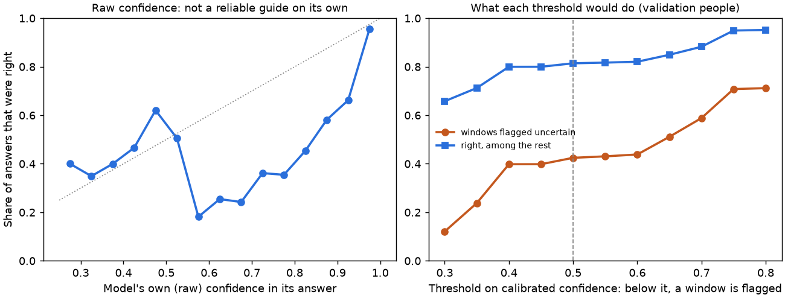

# Post-processing and screening: what it does and why

**Status: thresholds PROPOSED, waiting for Anna's approval.** They are in
`config.py`, marked "PROPOSED".

This covers requirements F.12 (flag low-confidence guesses) and F.13 (look
at neighbouring windows, smooth out unrealistic changes), plus the summary
and screening steps of the design (Requirements Specification, section 6.4).
Code: `sleepmon/postprocess.py`, `sleepmon/summary.py`,
`sleepmon/screening.py`, `sleepmon/report.py`.

Every threshold below was chosen on the **validation people** with the model
the app runs. The test people were used once, only to check the result.
To measure again:

```bash
python scripts/tune_postprocess.py data/models/sequence-default-magnitude-common_floor-balanced-test.pt
```

```bash
python scripts/build_reference.py data/models/sequence-default-magnitude-common_floor-balanced-test.pt
```

## The thresholds at a glance

| Setting | Proposed | Where it comes from |
|---|---|---|
| Smoothing: average over | 6 windows (30 s) | The length of one expert scoring period |
| Smoothing: shortest stage run kept | 6 windows (30 s) | The shortest run an expert can score |
| "The wrist really moved" | 0.10 (scaled movement) | Above what 99% of expert-scored Deep sleep reaches on every device |
| Low confidence | below 0.50 calibrated | "More likely wrong than right" on people the model never saw |
| Shortest recording screened | 3 hours usable | The shortest healthy reference nights are about 3.5 hours |
| Screening levels | 0 numbers outside = low, 1 = medium, 2 or more = high | See "Screening" |

## 1. Smoothing (F.13)

Each window's stage likelihoods are averaged with its neighbours' over 30
seconds. Then any stage run shorter than 30 seconds is handed to the
neighbouring stage the model found more likely. **Exception:** a short Awake
run where the wrist really moved is kept. Brief awakenings are real, and the
screening counts them.

| On the validation people | Macro F1 | Kappa | Stage changes per hour |
|---|---|---|---|
| Expert labels | | | 5.2 |
| No smoothing | 0.519 | 0.438 | 9.0 |
| **Proposed (30 s, 30 s)** | **0.519** | **0.439** | **5.7** |
| Strongest tried (2 min, 1 min) | 0.522 | 0.442 | 4.4 |

Smoothing hardly changes the scores, because the LSTM already reads the
night in order. What it fixes is the jumping: unsmoothed, the model changes
stage almost twice as often as the experts. The proposed setting brings that
close to the experts' rate without hiding anything shorter than what an
expert could score. Stronger settings score about the same, but would start
removing short REM periods and awakenings.

### "The wrist really moved"

Movement is the average strength of the window's movement spectrogram, on
the common-floor scale (0 = no movement above the noisiest device's floor).
Measured on training people, by the expert's stage:

| 99th percentile in Deep sleep | Apple Watch (Walch) | Apple Watch (BIDSleep) | GENEActiv (Newcastle) |
|---|---|---|---|
| | 0.026 | 0.033 | 0.068 |

0.10 is just above the highest of these, so a still sleeper on any of the
devices does not count as moving.

## 2. Low confidence (F.12)



**The model's own confidence cannot be trusted as it is** (left plot). When
it was 55 to 85% sure, it was right only 18 to 58% of the time, worse than
when it was 45% sure. Most of these are Awake answers. The class weights that
make the model find rare stages (docs/RESULTS.md) also make it over-sure of
them.

**The fix: calibration.** On the validation people, for each stage the model
can answer, we measured how often answers at each confidence level were
right. That becomes the confidence the app shows: "of answers like this on
people the model never saw, X% were right". It is stored in
`models/stage_model/calibration.json`.

**Proposed threshold: 0.50.** A window is flagged "uncertain" when answers
like it were wrong more often than right.

| Calibrated threshold | Flagged (validation) | Right among the rest | Right among flagged |
|---|---|---|---|
| 0.30 | 12% | 66% | 24% |
| 0.40 | 40% | 80% | 32% |
| **0.50** | **43%** | **81%** | **33%** |
| 0.70 | 59% | 88% | 42% |

**Checked once on the test people:** 56% flagged. The rest were right 71% of
the time, and the flagged ones only 28%. So the flag does separate trustworthy
answers from untrustworthy ones on new people.

**What this means for the page, and a decision for you:**
the best that any Deep answer reached was 39% right, and any REM answer 30%.
**At 0.50, every Deep and REM answer is flagged uncertain.** That is honest
about this model. The timeline would still show the model's best guess, marked
as uncertain, rather than hiding it. The alternative is 0.30, which flags only
the worst 12% and leaves many Deep and REM answers unflagged, even though most
of them are wrong. I recommend 0.50.

## 3. Night summary

Counted from the smoothed stages. Unusable windows count only as "unusable".

| Number | Meaning |
|---|---|
| Total sleep | Light + Deep + REM minutes |
| Sleep efficiency | Total sleep / usable recording time |
| Sleep onset, latency | Start of the first 10 minutes that are at least 90% sleep; the minutes before it |
| WASO | Awake minutes between sleep onset and the last sleep |
| Awakenings | Awake runs of at least 1 minute after sleep onset |
| Brief awakenings | Shorter Awake runs (kept only when the wrist moved) |
| Restless minutes | Minutes after sleep onset in which the wrist really moved at least once |
| Minutes and % per stage | Shown, but not used for screening (Deep and REM are unreliable) |
| Uncertain share | Share of usable windows flagged low confidence |

`tests/test_summary.py` checks each number against a night worked out by hand.

## 4. Screening

**What it is:** a comparison of three numbers with the range seen in healthy
people's nights. **What it is not:** a diagnosis. The page says so every time.

1. **Healthy reference:** the model and all the steps above, run on healthy
   people it never trained on (Walch and BIDSleep, validation and test),
   cut to the time in bed. Because these numbers come from the model, not
   from the experts, the comparison is like for like.
2. **The three numbers:** sleep efficiency (worse when lower), awakenings
   per hour of sleep, restless minutes per hour of sleep (worse when higher).
   These are what wrist movement measures best. Stage percentages are left out
   because Deep and REM are unreliable. Sleep latency is left out because it
   depends on when the recording was started.
3. **Range:** smallest to largest healthy value. With 20 or more healthy
   nights (the Colab run will have many more), the 5th to 95th percentile.
4. **Level:** count the numbers outside the range on the worse side.
   0 = low, 1 = medium, 2 or 3 = high.
5. **Too short:** under 3 hours of usable recording, no level, only a message.

### Reference ranges (8 healthy Walch nights, laptop data)

| Number | Healthy range |
|---|---|
| Sleep efficiency | 76.5% to 93.0% |
| Awakenings per hour of sleep | 0.6 to 2.7 |
| Restless minutes per hour of sleep | 2.7 to 10.3 |

### What the rule does (`results/screening_check.json`)

| Nights | Low | Medium | High |
|---|---|---|---|
| Healthy, each against a range built from the other 7 | 6 | 1 | 1 |
| Newcastle patients with a sleep disorder (14) | 0 | 3 | 11 |
| Newcastle patients with no disorder found (5) | 1 | 0 | 4 |

All Newcastle people here are ones the model never trained on, including 14
whose clocks could not be lined up for stage labels. Whole-night numbers
barely depend on that (docs/DATASETS.md).

### What this honestly shows

- **False alarms on healthy nights:** 2 of 8 got medium or high. Expect
  roughly one healthy night in four to be flagged with a range this narrow.
- **It flags patients:** 14 of 14 with a disorder got medium or high.
- **But it does not tell disorder from no disorder.** Among people on the
  same device in the same clinic, 4 of 5 without a disorder were also rated
  high. The flags mostly separate "sleep clinic, GENEActiv" from "sleep lab
  volunteer, Apple Watch". Part of that is real: clinic patients without a
  diagnosis were still referred for poor sleep, and slept in a lab. Part of it
  is the device and the model: on GENEActiv nights the model called a lot more
  time Awake than the experts did. For example, one night came out at 31%
  efficiency where the experts had 92%.
- **The experts' own numbers overlap too.** Expert-scored efficiency was
  15% to 92% for disorder nights and 67% to 94% for no-disorder nights.
  One night's sleep numbers are a weak sign of a disorder, even when scored
  by experts.

So the screening level means "this night looks unusual compared with healthy
sleepers", which is what the page says, and nothing more. The healthy range
will be rebuilt from far more nights in the Colab run (all of BIDSleep).
Recording the team's own wearable on healthy nights would give a reference on
the same device, which would remove the device problem.
