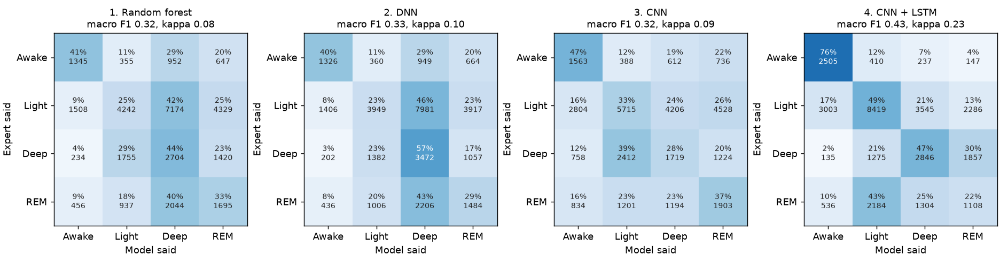

# Model results

**These are preliminary numbers from a laptop run.** The laptop has only 3 of
BIDSleep's nights, so the test set is just **6 people**: 4 from Walch and 2
from Newcastle. With so few people, one unusual sleeper can move a score by
several points. The real results come from the Colab run on all of BIDSleep
(`notebooks/train_models.ipynb`), which will replace the tables here.

Measured on 17 November 2026. Every number comes from a file in `results/`,
and can be remade with:

```bash
python scripts/summarise_results.py
```

```bash
python scripts/plot_results.py --on test
```

## In one paragraph

The best model is **model 4, a CNN feeding an LSTM** (it reads the night's
windows in order). On test people it never saw, it agreed with the sleep
experts on **47%** of 5-second windows, with **macro F1 0.43** and
**kappa 0.23** ("fair" agreement). Models 1 to 3, which look at one 5-second
window at a time, all scored about **0.32** macro F1 and kappa near **0.1**,
barely above chance. Reading windows in order is what helps. Heart rate
helps further: on Walch, macro F1 went from 0.36 to 0.44. These numbers are
far from a sleep lab's, which is why the app is a screening aid and never a
diagnosis.

## How the test was kept fair

- **People, not nights, are split** into train / validation / test
  (`splits/people_split.json`), so nobody's sleep is learned and then tested.
- **Every choice was made on the validation people:** which input, which
  scaling, frame length, class weights, and when to stop training.
- **The test people were used once**, after all choices were fixed, with one
  command (`--score-on test`). Nothing was changed after seeing them.
- For validation and test, each Newcastle patient counts once (left wrist).
  Training uses both wrists.
- Two Walch recordings made at 10 readings per second, and nights whose labels
  are not lined up with the motion, are left out (see `docs/DATASETS.md`).

| Set | Walch | BIDSleep | Newcastle | Scored 5 s windows |
|---|---|---|---|---|
| Train | 21 people | 2 people, 3 nights | 8 people, both wrists | 219,201 |
| Validation | 4 | 0 | 3 | 34,157 |
| Test | 4 | 0 | 2 | 31,797 |

## Test results (the final numbers)

Settings: magnitude input, common-floor scaling, 1 s frames, balanced class
weights, no heart rate. The same for all four models.

| Model | Accuracy | Macro F1 | Kappa | F1 Awake | F1 Light | F1 Deep | F1 REM |
|---|---|---|---|---|---|---|---|
| 1. Random forest | 0.31 | 0.32 | 0.08 | 0.39 | 0.35 | 0.28 | 0.26 |
| 2. DNN | 0.32 | 0.33 | 0.10 | 0.40 | 0.33 | 0.34 | 0.24 |
| 3. CNN | 0.34 | 0.32 | 0.09 | 0.34 | 0.42 | 0.25 | 0.28 |
| **4. CNN + LSTM** | **0.47** | **0.43** | **0.23** | **0.53** | **0.57** | **0.41** | 0.21 |

How to read these:

- **Accuracy** looks low partly because of the class weights. A model that
  always answered "Light" would score 54% here, while finding no Awake, Deep or
  REM at all. That is why macro F1 is the main score.
- **Macro F1** averages the four stages equally. 0.25 would be guessing.
- **Kappa** is agreement beyond chance. 0 is chance, 0.2 to 0.4 is usually
  called "fair", and two human experts scoring the same night typically reach
  around 0.75 (from memory of the literature, not measured here).

### Confusion matrices

Rows are what the expert said, columns what the model said. Each row adds up
to 100%, so the diagonal is how much of each real stage the model found.



What they show:

- **Model 4 finds 76% of Awake time**, and rarely calls real sleep Awake.
  Telling awake from asleep is what wrist movement does best.
- **Light is often called Deep** by every model. A still wrist looks the same
  in both.
- **REM is the hardest.** In REM the body's muscles are relaxed, so a wrist in
  REM looks like a wrist in Light or Deep sleep. Model 4 finds only 22% of it.
- Models 1 to 3 spread their answers almost evenly. On a single 5-second
  window there is little to go on.

### Model 4, by dataset

| Test people | Accuracy | Macro F1 | Kappa | F1 Awake | F1 Light | F1 Deep | F1 REM |
|---|---|---|---|---|---|---|---|
| Walch (4, Apple Watch, lab) | 0.47 | 0.40 | 0.18 | 0.42 | 0.62 | 0.32 | 0.24 |
| Newcastle (2, GENEActiv, sleep clinic patients) | 0.47 | 0.42 | 0.29 | 0.61 | 0.46 | 0.47 | 0.12 |

On Newcastle, REM is almost never found. That is two people, so it may say
more about those two than about the device.

## Heart rate (model 4, Walch and BIDSleep only)

Newcastle has no heart rate, so this comparison trains and tests on Walch and
BIDSleep only. Everything else is the same.

| Model 4 | Accuracy | Macro F1 | Kappa | F1 Awake | F1 Light | F1 Deep | F1 REM |
|---|---|---|---|---|---|---|---|
| Movement only | 0.37 | 0.36 | 0.14 | 0.30 | 0.43 | 0.41 | 0.29 |
| **Movement + heart rate** | **0.53** | **0.44** | **0.25** | 0.35 | **0.65** | 0.38 | **0.38** |

Heart rate helps most with Light and REM, as expected: in REM the heart beats
faster and less evenly than in deep sleep. Tested on 4 people.

**The app uses the movement-only model** for now, because it works on every
upload. Many uploads, including every GENEActiv night and possibly the
team's wearable, have no heart rate. A heart rate model could be used
automatically when the upload has an `hr` column. That is a decision for the
team (see "Open questions").

## Class imbalance: did the weighting work?

Over half of all windows are Light, and few are Deep or REM. Without help, a
model learns to say "Light" and ignore the rare stages. The fix: while
learning, a mistake on a rare stage costs more (each stage's weight is
1 / its share). To show it worked, every model was trained both ways
(validation people, xyz input):

| Model | Weights | Accuracy | Macro F1 | Deep found | REM found | Light found |
|---|---|---|---|---|---|---|
| Random forest | none | 0.55 | 0.32 | 3% | 1% | 95% |
| Random forest | balanced | 0.42 | **0.37** | **42%** | **31%** | 25% |
| DNN | none | 0.56 | 0.34 | 6% | 0% | 91% |
| DNN | balanced | 0.42 | **0.38** | **41%** | **39%** | 23% |
| CNN | none | 0.55 | 0.35 | 5% | 2% | 85% |
| CNN | balanced | 0.46 | **0.38** | **25%** | **40%** | 25% |
| CNN + LSTM | none | 0.64 | 0.44 | 29% | 0% | 79% |
| CNN + LSTM | balanced | 0.55 | **0.48** | **33%** | **65%** | 33% |

Without the weights, models score higher accuracy by answering "Light"
almost every time, and find almost no REM. With them, every model finds far
more Deep and REM, and macro F1 rises for all four. The cost is more Light
windows wrongly called something else, which is the right trade for a
screening aid that must not ignore the rare stages.

## The choices, and how they were made (validation people)

The same model 4 was trained with one setting changed at a time. To know
which differences are real, it was also trained three times with only the
random starting point changed: **its macro F1 moved between 0.46 and 0.48 by
chance alone.** A difference smaller than about 0.03 is not evidence.

| Question | Tried | Macro F1 (model 4) | Chosen |
|---|---|---|---|
| Input version | xyz (3 starts) | 0.46, 0.48, 0.48 | |
| | **magnitude** (3 starts) | **0.50, 0.51, 0.52** | **magnitude** |
| GENEActiv noise | **common floor** | **0.48** | **common floor** |
| | absolute | 0.47 | |
| | relative to each night | 0.48 | |
| Frame length | **1 s** | **0.48** | **1 s** |
| | 2 s | 0.45 | |
| Model kind | LSTM | see above | **LSTM** |
| | Transformer | not tried | |

- **Magnitude beat xyz** in all three repeats. It also does not care how the
  sensor is strapped on, which suits a home-made wearable.
- **The three ways of handling the noisier GENEActiv** came out the same,
  within chance. Common floor was kept as the simplest. The random forest
  preferred "relative" (0.40 against 0.37), but that is the weaker model.
- **2 s frames were slightly worse**, within chance, and cost more memory.
- **A Transformer was not tried.** The plan said "if time allows". The LSTM
  is small (0.5 MB) and fast on a processor, which the app needs.

## Can the app run it? (Streamlit Community Cloud: 2 processors, 2.7 GB)

The network is saved as ONNX and run with onnxruntime, so the app does not
need PyTorch (over 1 GB). Measured on this laptop, limited to 2 threads:

| | Result |
|---|---|
| Model file | 0.5 MB |
| 8-hour night, signal processing | 0.8 s |
| 8-hour night, model | 0.4 s |
| 16-hour night, model | 0.9 s |
| Peak memory, whole 8-hour path including making the test file | about 1.0 GB |

Before it is written, the ONNX copy is checked against the original on every
test night. The largest difference was 0.000002.

## Honest limits

- **Six test people.** Every number above could move by several points with
  different people. The Colab run will have far more.
- **Device and patient group are tangled.** All patients wore the GENEActiv,
  and all healthy people wore an Apple Watch. A difference between groups may
  partly be a difference between devices.
- **The team's wearable (MPU-6050) is not in any training set.** Its noise
  level and mounting will differ. Its results cannot be predicted from these
  numbers. Recording a few nights alongside a reference would be the way to
  find out.
- **Wrist movement cannot see the brain.** Sleep stages are defined by brain
  waves. Movement and heart rate are indirect clues, which is why Light, Deep
  and REM are often confused.

## Open questions for the team

1. Use the heart rate model automatically when an upload has an `hr` column?
   It scored better on Walch (macro F1 0.44 against 0.36, 4 people).
2. Try a Transformer in place of the LSTM in the Colab run? It would cost
   another hour of training. The app limits leave room for it.

## Files

| File | What it is |
|---|---|
| `results/*.json` | Every run: settings, people per set, training history, all scores, confusion matrix |
| `models/stage_model/` | The model the app runs (`model.onnx`) and what it is (`model.json`) |
| `scripts/train_models.py` | Trains and scores any model with any setting |
| `scripts/export_model.py` | Makes the app's model file, after checking it |
| `notebooks/train_models.ipynb` | The same, in free Google Colab, with all of BIDSleep |
