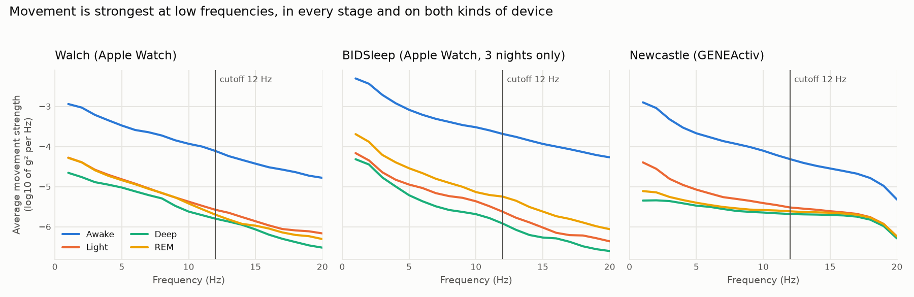
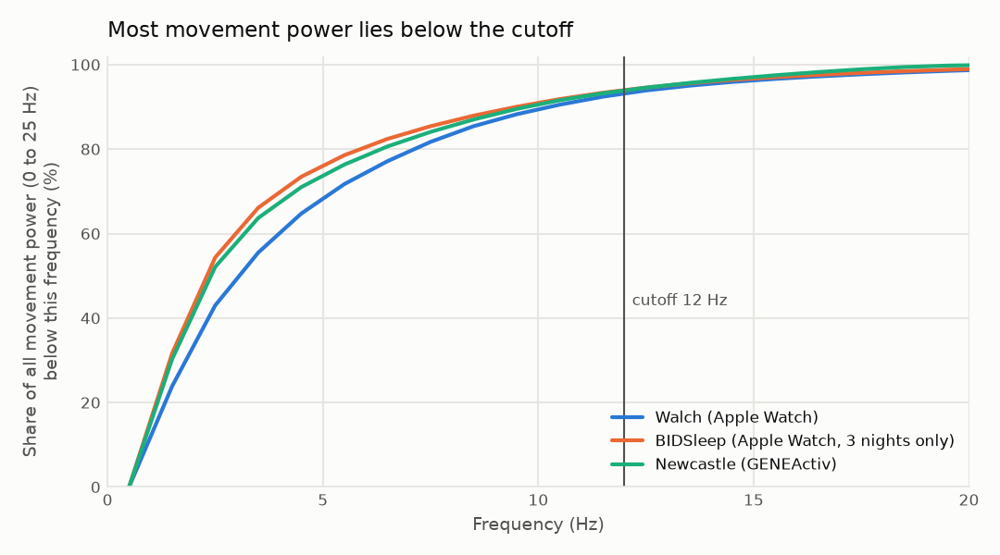
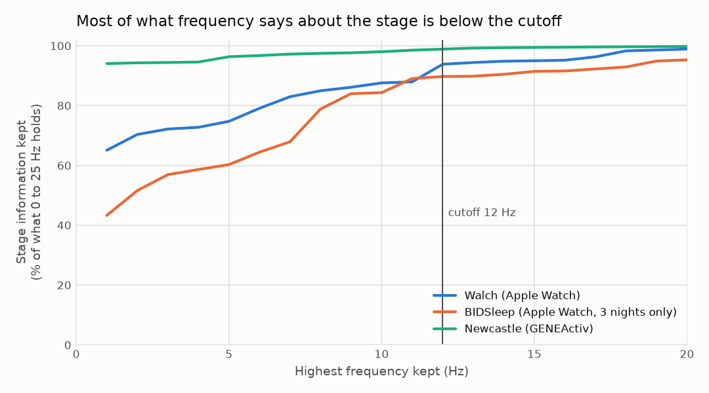
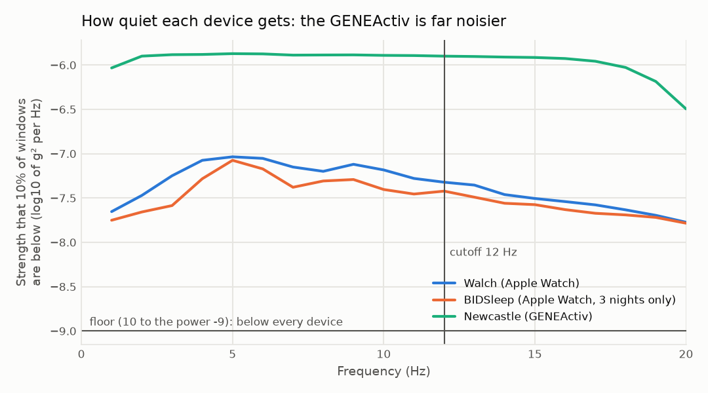

# Signal processing: what it does and why

This covers requirements F.1 to F.9. The code is in
`sleepmon/signal_processing.py` (the steps) and `sleepmon/pipeline.py` (the
steps in order). The same code runs on the training datasets and on a user's
upload, so a model always sees data prepared the way it was trained.

Every number here was measured, on 16 and 17 November 2026. To measure again:

```bash
python scripts/frequency_study.py --recompute
```

```bash
python -m pytest tests/test_signal_processing.py tests/test_pipeline.py -s
```

## The chain

| Step | What happens | Why this way |
|---|---|---|
| 1. Read | 3 or 6 motion channels, optional heart rate. See `docs/CSV_FORMAT.md` | |
| 2. Remove impossible readings | Acceleration beyond ±16 g or rotation beyond ±2000 °/s | Done first, so one absurd value cannot smear into its neighbours through the filters |
| 3. Resample to 50 per second | A smooth curve through the readings, read off on an even clock | Devices record at different, uneven rates. See "Resampling" |
| 4. Split at 0.5 Hz | Fast part = body movement. Slow part = gravity, which shows how the wrist is turned | The filter runs forwards then backwards, so a movement stays at the moment it happened. Fast + slow gives back the original exactly |
| 5. Cut into 5 s windows | Consecutive, no overlap. A last part-window is dropped | |
| 6. Label | Each window takes the stage of its 30 s period, so each expert label covers six windows. N1 and N2 become Light, N3 becomes Deep | |
| 7. Flag | Gap, impossible value, or stuck sensor. See "Bad windows" | Flagged windows keep their place in the night but hold no numbers, so they cannot be used by accident |
| 8. Spectrogram | Each window is cut into 1 s frames that overlap by half (9 frames), and each frame is Fourier-transformed | Keeps both which frequencies and when |
| 9. Crop | Keep the rows from 1 to 12 Hz | See "The frequency cutoff" |
| 10. Log scale | log10 of the strength, with a floor | Movement strength spans a factor of millions. The log makes small and large both visible |

Each window ends up as a picture of 12 frequencies by 9 time steps per channel.

## The frequency cutoff: 12 Hz

Measured on **training-set people only** (20 Walch, 2 BIDSleep, 8 Newcastle),
so the choice was not made by looking at people we test on later. Two Walch
recordings made slower than 45 readings per second were left out of this
study, because they cannot show the upper frequencies at all.

### 1. Movement is strongest at low frequencies



In every stage and on both kinds of device, strength falls steadily as
frequency rises. Awake is roughly 15 to 35 times stronger than the strongest
sleep stage at every frequency. The sleep stages lie close together, which is
the honest picture of how hard they are to tell apart from movement alone.

### 2. About 94% of movement power is at or below 12 Hz



| Highest frequency kept | Walch | BIDSleep (3 nights) | Newcastle |
|---|---|---|---|
| 5 Hz | 72% | 79% | 76% |
| 10 Hz | 91% | 92% | 92% |
| **12 Hz** | **94%** | **95%** | **95%** |
| 13 Hz | 95% | 96% | 96% |
| 20 Hz | 99% | 99% | 100% |

The three datasets agree closely. There is no sharp edge: the curve bends
gradually, so power alone does not pick the cutoff.

### 3. Most of what frequency says about the stage is at or below 12 Hz



A single frequency says about as much as any other, because a movement is a
burst that shows up at all frequencies at once. The useful question is what
higher frequencies add beyond the lower ones. The plot answers that: for
each cutoff, how much of the stage information in the full 0 to 25 Hz range
is kept. (The measure is the share of the joint variation in strength that
the stage explains, a standard statistic. It only captures straight-line
relationships, so read it as a guide, not as a prediction of model accuracy.)

| Highest frequency kept | Walch | BIDSleep (3 nights) | Newcastle |
|---|---|---|---|
| 5 Hz | 75% | 60% | 96% |
| 10 Hz | 88% | 84% | 98% |
| 11 Hz | 88% | 89% | 98% |
| **12 Hz** | **94%** | **90%** | **99%** |
| 13 Hz | 94% | 90% | 99% |
| 20 Hz | 99% | 95% | 100% |

On the Apple Watch the curve climbs up to 12 Hz and then flattens. On the
GENEActiv almost everything is already in the first few hertz, because its
higher frequencies are buried in sensor noise (next plot).

### 4. Why not keep everything up to 25 Hz



- **Little is gained.** Going from 12 to 20 Hz adds about 5 points of stage
  information on Walch and about 1 on Newcastle, for two thirds more input.
- **The upper range is where devices differ most.** A recording that had to
  be slowed down (85.7 to 50 per second) must be filtered above 20 Hz. One
  recorded at 50 is not. Keeping those rows would hand the model a way to
  tell devices apart, and in our data device and patient group are tangled.
- **The wearable's own filter.** The MPU-6050 has built-in low-pass settings
  at 21 Hz and below. A 12 Hz cutoff leaves room for them.

**Chosen: rows 1 to 12 Hz.** The 0 Hz row is dropped, since a constant is
not movement and the gravity filter has already removed it.

BIDSleep's numbers come from three nights and should not be leaned on. They
will be re-checked on the full dataset in Colab.

## Resampling

Straight lines between readings are the simple way to put a recording on an
even clock. Tested on a clean 12 Hz movement, in the worst case (readings
falling halfway between the ticks of the new clock), they shrink it, and by a
different amount at each recording rate:

| Recorded at | Kept with straight lines | Kept with a smooth curve |
|---|---|---|
| 50 per second | 73% | 98% |
| 52.4 per second | 84% | 99% |
| 66.6 per second | 90% | 100% |
| 85.7 per second | 94% | 100% |

The same movement would look weaker on an Apple Watch than on a GENEActiv,
only because of the arithmetic. On real nights the difference in the 12 Hz
row was 0.15 on the log scale for the Apple Watch and 0.05 for the GENEActiv.
So the resampler draws a smooth curve (a cubic spline) through each unbroken
stretch of readings. Across a hole it uses a straight line, because a curve
can swing wildly where there is no data.

Recordings faster than 50 per second are filtered before every second or
third reading is kept, so that fast wiggles are not mistaken for slow ones.
A test shows a 40 Hz wiggle is fully removed where careless thinning would
turn it into a fake 10 Hz movement.

## Bad windows

| Rule | Where the number comes from |
|---|---|
| **Gap:** more than 0.25 s without a reading | In the datasets, normal readings are never more than about 0.11 s apart, even in the slowest recordings. Real dropouts last many seconds. 0.25 s separates the two cleanly |
| **Impossible value:** beyond ±16 g or ±2000 °/s | The widest ranges the MPU-6050 can be set to. The largest acceleration in the datasets is about 8 g |
| **Stuck sensor:** identical acceleration for a whole window | A real sensor always jitters. Of about 90,000 real windows checked, including the stillest deep sleep, none was flat |

Motion is present for 95% of Walch's labeled time, 100% of the BIDSleep
sample and 98% of Newcastle's.

## Two input versions

Both are produced for every window, as F.7 and the mentor's notes ask:

- **xyz:** three channels, one spectrogram per axis.
- **magnitude:** one channel, the total size of the acceleration. It does not
  change when the sensor is mounted the other way round. A test checks that.

Which works better is measured in Phase 3, with the same model on both.

The slow part (wrist position) is kept alongside as three numbers per time
step. A spectrogram of something that barely changes in 5 seconds would say
nothing, but its level does.

## Speed (F.9)

An 8-hour, 6-channel recording with heart rate, 81 MB as a CSV, is processed
in about 1.5 seconds on this laptop. The requirement is under 10 minutes. The
test fails if it ever takes more than 60 seconds.

## Things that showed up and are settled in Phase 3

These need a model to judge, so they are noted here and not decided by guess.

1. **The GENEActiv is roughly 15 to 40 times noisier than the Apple Watch,**
   depending on the frequency. Its quietest moments read about 10^-5.9 where
   the watch reads between 10^-7.0 and 10^-7.7. To a
   model, a still wrist on a GENEActiv could look like slight movement on a
   watch. Since all patients wore the GENEActiv, this could make patients
   look more restless than they are. Phase 3 will compare ways of dealing
   with it (for example measuring strength relative to each night's own
   quietest level) and report what it does to the results per dataset.
2. **Two Walch people were recorded at 10 readings per second** (5383425 in
   train, 8258170 in validation). Their rows above 5 Hz are empty. They are
   marked (`source_rate_ok` is False). My recommendation is to leave them out
   of stage training and testing.
3. **Frame length.** 1 s frames give 9 time steps and 1 Hz rows. 2 s frames
   would give finer rows and fewer steps. The code takes either. The plan
   said to compare them in Phase 2, but a fair comparison needs a model, so
   it moves to Phase 3.
4. **The floor is 10^-9**, below the quietest any device gets. It only stops
   the log of zero. It does not make devices alike. That is point 1.
